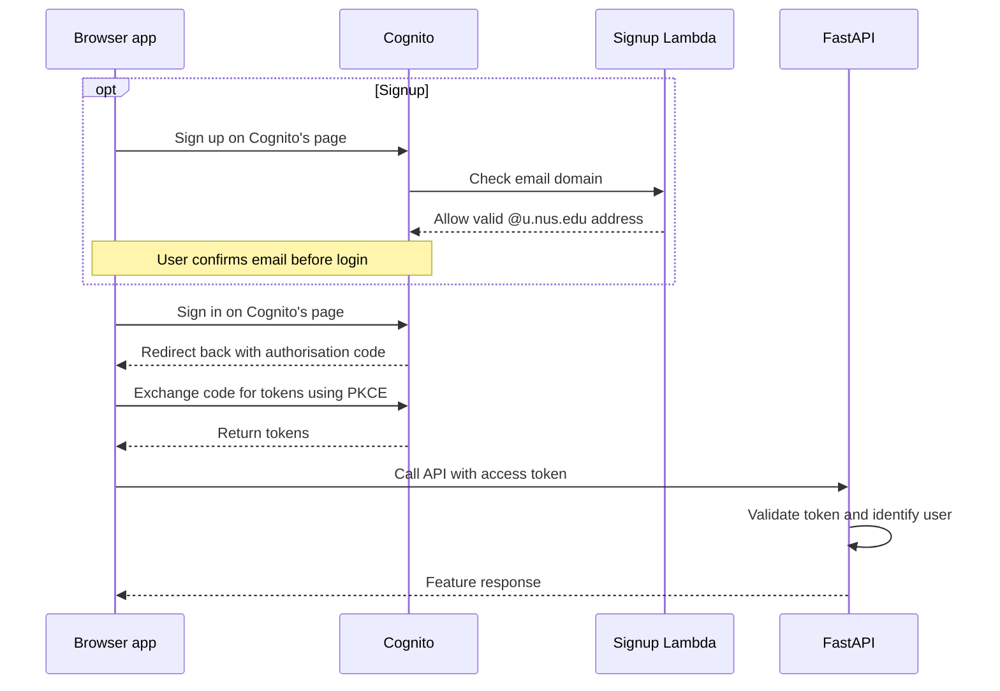

# Authentication

Use Cognito for signup, email confirmation, and login, and Cognito access tokens to authenticate requests to FastAPI. Signup requires an `@u.nus.edu` address.

## How it works



1. **Sign up:** use an `@u.nus.edu` address and confirm the emailed code. The signup Lambda rejects other domains.
2. **Sign in:** use Cognito's hosted page. Cognito redirects to the app with a temporary authorisation code.
3. **Exchange code for tokens:** check `state` and exchange the code using S256 PKCE, which ties the exchange to the app that started login. No client secret is used.
4. **Access a feature that requires login:** e.g. posting a comment in the forum. Include the access token in the API request.

## Using authentication in features

- **Frontend:** use the region, pool ID, public client ID, and hosted domain from the stack outputs. Register exact callback/logout URLs and use HTTPS outside local development. Handle the login callback, token refresh, and logout; send API requests with `Authorization: Bearer <access_token>`.
- **Backend:** use `Depends(get_current_user)` from `app.auth` on protected routes. It validates the token's signature, expiry, issuer, app-client `client_id`, `token_use=access`, and non-empty `sub`. Use the returned `user_id` (the verified `sub`), rather than a caller-supplied ID.
- **Feature permissions:** check ownership separately where required. For example, take a comment's author from the authenticated user and allow edits only by its owner.

`GET /auth/me` returns `{"user_id": "<sub>"}`. Missing or invalid credentials return `401` with a Bearer challenge; missing configuration or unavailable signing keys return `503`. `GET /health` is public.

## Tokens and access

| Token | Purpose |
| --- | --- |
| Access token | Credential for protected API requests; expires after 15 minutes. |
| ID token | Identity information for the frontend; do not use it as an API credential. |
| Refresh token | Obtains new tokens from Cognito; expires after 30 days. |

- Email addresses cannot change after signup. Email confirmation proves mailbox access, not current NUS enrolment.
- On logout, clear local tokens, revoke the refresh token, and end the Cognito hosted session. Access tokens can still pass local validation until expiry.
- Keep passwords, tokens, confirmation codes, and AWS credentials out of logs and source control. Application integration uses public configuration, not AWS keys.

## Local configuration

From `backend/`, copy [`.env.example`](../backend/.env.example) to `.env.local` and fill in the public values from the deployment's stack outputs:

```dotenv
AWS_REGION=ap-southeast-1
COGNITO_USER_POOL_ID=<user-pool-id>
COGNITO_CLIENT_ID=<public-client-id>
COGNITO_DOMAIN=https://<domain-prefix>.auth.ap-southeast-1.amazoncognito.com
```

Start the API with `poetry run uvicorn app.main:app --reload --env-file .env.local`.

## Deployment

Deploy [infra/auth.yaml](../infra/auth.yaml) with AWS CLI v2 in `ap-southeast-1`. This creates the authentication resources; deploy the FastAPI application separately.

Configure an AWS profile with permissions for CloudFormation, S3, Cognito, Lambda, CloudWatch Logs, and IAM role creation/pass-role. Create a private S3 bucket in the same region with public access blocked to hold the Lambda deployment package.

### Package and review

Run from the repository root in PowerShell:

```powershell
$awsProfile = '<development-profile>'
$artifactBucket = '<private-artifact-bucket>'
$domainPrefix = '<unique-hosted-domain-prefix>'

aws sts get-caller-identity --profile $awsProfile
New-Item -ItemType Directory -Force build | Out-Null
aws cloudformation package --template-file infra/auth.yaml --s3-bucket $artifactBucket --s3-prefix lecture-kaki/auth --output-template-file build/auth.packaged.yaml --region ap-southeast-1 --profile $awsProfile
aws cloudformation validate-template --template-body file://build/auth.packaged.yaml --region ap-southeast-1 --profile $awsProfile
aws cloudformation deploy --template-file build/auth.packaged.yaml --stack-name lecture-kaki-auth-dev --parameter-overrides "DomainPrefix=$domainPrefix" --capabilities CAPABILITY_IAM --no-execute-changeset --region ap-southeast-1 --profile $awsProfile
```

Packaging uploads the signup Lambda. The final command prepares a change set without applying it. Review the proposed changes, particularly any user-pool replacement:

```powershell
$changeSetArn = '<printed-change-set-arn>'
aws cloudformation describe-change-set --change-set-name $changeSetArn --region ap-southeast-1 --profile $awsProfile
```

The template defaults to callback `http://localhost:8000/docs/oauth2-redirect` and logout destination `http://localhost:8000/docs`. Override `CallbackURLs` and `LogoutURLs` when deploying for a different client.

### Apply and verify

Execute the reviewed change set:

```powershell
aws cloudformation execute-change-set --change-set-name $changeSetArn --region ap-southeast-1 --profile $awsProfile
```

Wait for the stack to finish successfully, then read its public configuration:

```powershell
aws cloudformation describe-stacks --stack-name lecture-kaki-auth-dev --query 'Stacks[0].Outputs' --region ap-southeast-1 --profile $awsProfile
```

Verify signup, rejection of other email domains, email confirmation, login, password recovery, and protected API access using a real NUS mailbox.

The user pool is retained on stack deletion/replacement; remove retained resources and S3 deployment packages when no longer needed. Lambda logs expire after 14 days. Default Cognito email delivery is limited to 50 messages per account per day; see [AWS email limits](https://docs.aws.amazon.com/cognito/latest/developerguide/quotas.html).

References: [backend setup](../backend/README.md), [signup Lambda](../backend/lambdas/pre_signup/handler.py), [Cognito code and PKCE flow](https://docs.aws.amazon.com/cognito/latest/developerguide/authorization-endpoint.html), and [JWT verification](https://docs.aws.amazon.com/cognito/latest/developerguide/amazon-cognito-user-pools-using-tokens-verifying-a-jwt.html).
